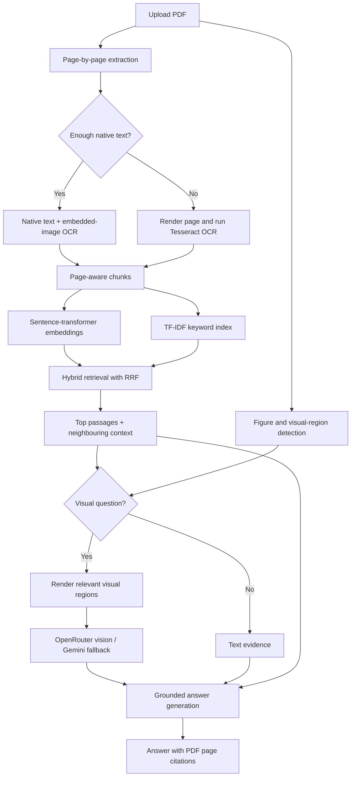

# DocuMind AI — Intelligent PDF Question Answering

DocuMind AI is a Streamlit application for exploring PDF documents through natural-language questions. It combines page-aware PDF extraction, local OCR, hybrid information retrieval, and retrieval-augmented generation (RAG) to produce answers linked to evidence in the original document.

It also supports questions about detected figures and other visual content by extracting relevant regions from the PDF and analysing them with a multimodal model.

## Key features

- **PDF text extraction:** Extracts text page by page while retaining the original PDF page numbers.
- **OCR for scanned pages:** Uses Tesseract OCR when a page contains little or no selectable text.
- **Embedded-image OCR:** Attempts OCR on sufficiently large embedded images, including images inside otherwise text-based PDFs.
- **Hybrid retrieval:** Combines sentence-transformer semantic search with TF-IDF keyword search using Reciprocal Rank Fusion (RRF).
- **Context expansion:** Adds neighbouring chunks around high-ranking passages to provide the answer model with additional context.
- **Evidence-grounded answers:** Prompts the language model to answer from retrieved PDF passages and relevant visual evidence rather than inventing unsupported details.
- **Page-level citations:** Maps passage and visual evidence references back to PDF page numbers. Select a cited page in the interface to inspect its supporting passage.
- **Visual question answering:** Detects figure captions and estimates their associated visual regions. Relevant regions can be rendered and analysed for diagrams, charts, tables, labels, values, and relationships.
- **Multimodal provider fallback:** Tries OpenRouter first and Gemini as a fallback for answer generation and visual analysis.
- **Conversational PDF chat:** Supports contextual follow-up questions, independent questions, and actions to simplify, expand, summarise, or illustrate an answer.
- **Automated tests:** Includes tests for retrieval, OCR, citation handling, prompt construction, and provider error handling.

## How it works

The application follows a document-grounded RAG workflow:

1. **Upload:** The user uploads a PDF through the Streamlit interface.
2. **Extract:** Native text is extracted page by page. Pages with insufficient selectable text are rendered and processed with Tesseract OCR. Larger embedded images on text-based pages are also considered for OCR.
3. **Prepare:** Extracted text is divided into overlapping, page-aware chunks.
4. **Index:** The application creates sentence-transformer embeddings and a TF-IDF keyword index.
5. **Retrieve:** A question is searched against both indexes. Their rankings are combined using Reciprocal Rank Fusion, and neighbouring chunks are added for context.
6. **Inspect visuals when requested:** For questions about figures, diagrams, charts, tables, or images, the application uses figure captions and page context to select relevant visual regions. Selected regions are rendered from the original PDF and sent for multimodal analysis.
7. **Generate:** Retrieved passages and available visual descriptions are supplied to the configured language model with instructions to stay grounded in the evidence.
8. **Review:** The answer is displayed with page citations. Users can open the cited pages' supporting passages and continue the conversation.



## Technology stack

| Area | Tools |
| --- | --- |
| User interface | Streamlit |
| PDF text extraction | pdfplumber |
| PDF rendering and visual extraction | PyMuPDF |
| OCR | Tesseract OCR, pytesseract, Pillow |
| Semantic retrieval | Sentence Transformers — `all-MiniLM-L6-v2` |
| Keyword retrieval | scikit-learn TF-IDF |
| Hybrid ranking | Reciprocal Rank Fusion (RRF) |
| Answer generation | OpenRouter and Google Gemini |
| Visual understanding | OpenRouter multimodal API and Google Gemini |
| Configuration | python-dotenv |
| Testing | pytest |

## Requirements

- Python 3.10 or newer
- Tesseract OCR installed on the machine
- An API key for at least one supported answer provider:
  - OpenRouter
  - Google Gemini
- Internet access for the configured language-model provider and for the initial download of the sentence-transformer model

### Install Tesseract OCR

Tesseract is a separate system application; installing the Python package `pytesseract` does not install the OCR engine.

**Windows**

1. Install Tesseract OCR for Windows.
2. Confirm that `tesseract --version` works in Command Prompt, or that the executable is available at the path configured in `src/ai_pdf_assistant/pdf_processing.py`.
3. The current Windows configuration checks:

   `C:\Program Files\Tesseract-OCR\tesseract.exe`

If Tesseract is installed elsewhere, add its folder to your system `PATH` or update `TESSERACT_PATH` in `pdf_processing.py`.

**macOS**

```bash
brew install tesseract
```

**Ubuntu / Debian**

```bash
sudo apt-get update
sudo apt-get install tesseract-ocr
```

## Installation

Clone the repository and enter the project directory:

```bash
git clone https://github.com/Imamjamiu/Ai-pdf-question-answering-assistant.git
cd Ai-pdf-question-answering-assistant
```

Create and activate a virtual environment.

**Windows Command Prompt**

```cmd
py -3.10 -m venv .venv
.venv\Scripts\activate
```

**macOS / Linux**

```bash
python3 -m venv .venv
source .venv/bin/activate
```

Install the dependencies and install the project in editable mode:

```bash
python -m pip install --upgrade pip
python -m pip install -r requirements.txt
python -m pip install -e .
```

## Configure API keys

Create a `.env` file in the project root. You can start from the supplied example:

**Windows Command Prompt**

```cmd
copy .env.example .env
```

**macOS / Linux**

```bash
cp .env.example .env
```

Add the API key or keys you intend to use:

```dotenv
OPENROUTER_API_KEY=your_openrouter_api_key
OPENROUTER_MODEL=openrouter/free

GEMINI_API_KEY=your_gemini_api_key
GEMINI_MODEL=gemini-3.8-flash

# Optional: model used for visual analysis through OpenRouter
OPENROUTER_VISION_MODEL=openrouter/free
```

Configure at least one provider key. When both providers are configured, the application tries OpenRouter first and then attempts Gemini if OpenRouter is unavailable or fails. The same provider order is used for visual analysis. Model names shown above are defaults; you can change them through the corresponding environment variables.

Keep real API keys in `.env`. Do not commit the file, paste keys into source code, or include them in screenshots. The repository provides `.env.example` as a template.

## Run the application

From the project root, with the virtual environment activated:

```bash
streamlit run main.py
```

Streamlit prints a local URL in the terminal. Open it in your browser, upload a PDF, and start asking questions.

### Example questions

- What are the main concepts discussed in this document?
- Explain this topic in simpler terms.
- What does Figure 2.3 illustrate?
- Explain the diagram on page 12.
- What do the values in this table represent?
- How are the components in this figure connected?
- Summarise your previous answer.
- Give me an example based on the explanation in the PDF.

For visual questions, refer to a figure number or page when possible. The application uses detected figure captions and page context to locate candidate visual regions.

## Run the tests

Run the complete test suite from the project root:

```bash
python -m pytest -v
```

The tests cover core retrieval behaviour, OCR on the bundled scanned-PDF fixture, citation normalisation, prompt construction, local helper behaviour, and provider error handling. OCR tests require Tesseract to be installed and accessible.

Passing automated tests does not establish that every generated answer is factually correct or that every PDF layout will be processed successfully. Live model quality, provider availability, and quota behaviour require separate testing with the relevant API credentials.

## Project structure

```text
.
├── main.py
├── pyproject.toml
├── requirements.txt
├── .env.example
├── pytest.ini
├── src/
│   └── ai_pdf_assistant/
│       ├── __init__.py
│       ├── answer_generation.py
│       ├── conversation.py
│       ├── pdf_processing.py
│       ├── retrieval.py
│       ├── visual_processing.py
│       └── visual_understanding.py
├── tests/
│   ├── fixtures/
│   │   └── scanned-document-sample-3-pages.pdf
│   ├── test_answer_generation.py
│   ├── test_pdf_ocr.py
│   └── test_retrieval_unit.py
└── evaluation/
    ├── answer_review.csv
    └── questions.json
```

| Module | Responsibility |
| --- | --- |
| `main.py` | Streamlit interface, PDF workflow, conversation handling, and evidence display |
| `pdf_processing.py` | Page-level text extraction, OCR, and merging native and OCR text |
| `retrieval.py` | Chunking, embeddings, TF-IDF indexing, hybrid retrieval, and context expansion |
| `visual_processing.py` | Embedded-image and vector metadata, figure-caption detection, region detection, and rendering |
| `visual_understanding.py` | Multimodal analysis of selected PDF visual regions |
| `answer_generation.py` | Grounded prompt construction, OpenRouter/Gemini requests, and citation normalisation |
| `conversation.py` | Follow-up detection, retrieval-query context, and citation display helpers |

## Limitations and responsible use

- **OCR is not perfect.** Results depend on scan resolution, image quality, text orientation, fonts, and language. Review extracted content when accuracy matters.
- **Visual detection depends on document layout.** Figure-region selection relies on detectable visual elements and captions in recognisable `Figure` or `Fig.` formats. Uncaptioned or unusually formatted visuals may not be selected.
- **Tables are not guaranteed to become structured data.** A table may be interpreted as a visual when it is included in a detected region, but the application does not guarantee accurate cell-by-cell extraction.
- **Answers can be incomplete or incorrect.** Page citations provide traceability to retrieved evidence; they are not a guarantee that an answer is correct. Inspect the supporting passages and original PDF.
- **External providers have limits.** Answer generation and visual analysis depend on the availability, rate limits, and quotas of OpenRouter and/or Gemini. If visual analysis is unavailable, the original extracted visual can still be retained, but its contents will not have been verified by a vision model.
- **Document data leaves the local machine when model analysis is requested.** OCR and PDF processing run locally, but retrieved text passages are sent to the configured language-model provider. When visual analysis is requested, selected rendered figure regions are also sent to the configured vision-capable provider. Do not upload confidential or sensitive documents unless you are authorised to share their contents with that provider.

## License

No license has been specified for this repository yet. If you intend others to use, modify, or redistribute the project, add an appropriate open-source license file.
